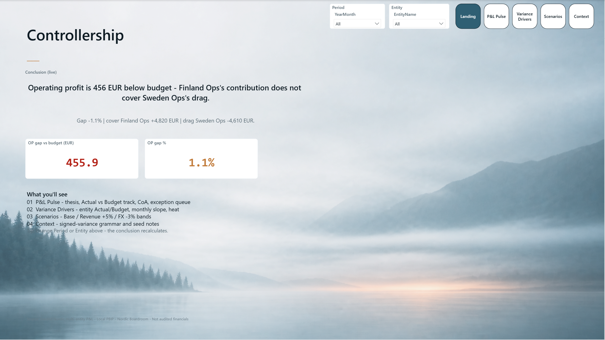
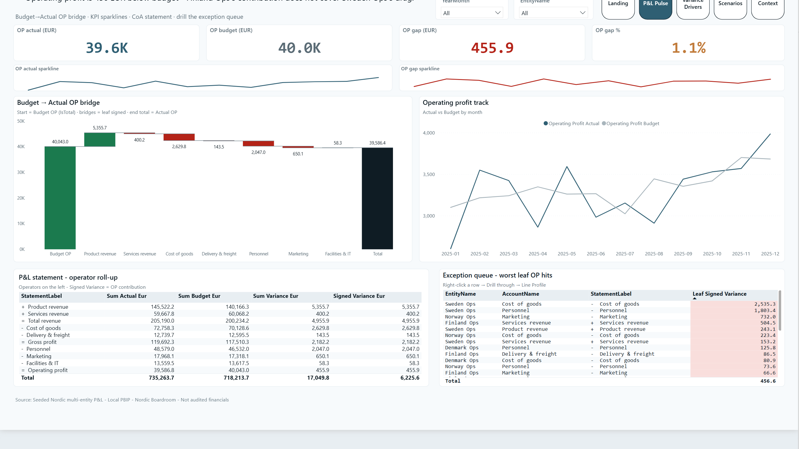
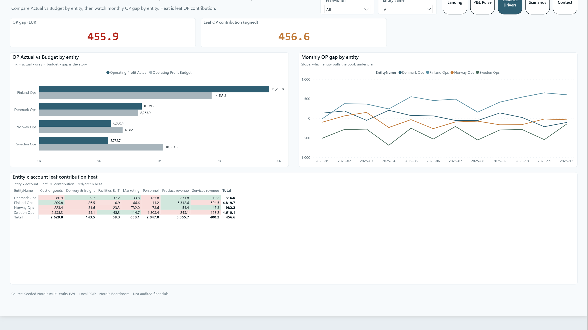
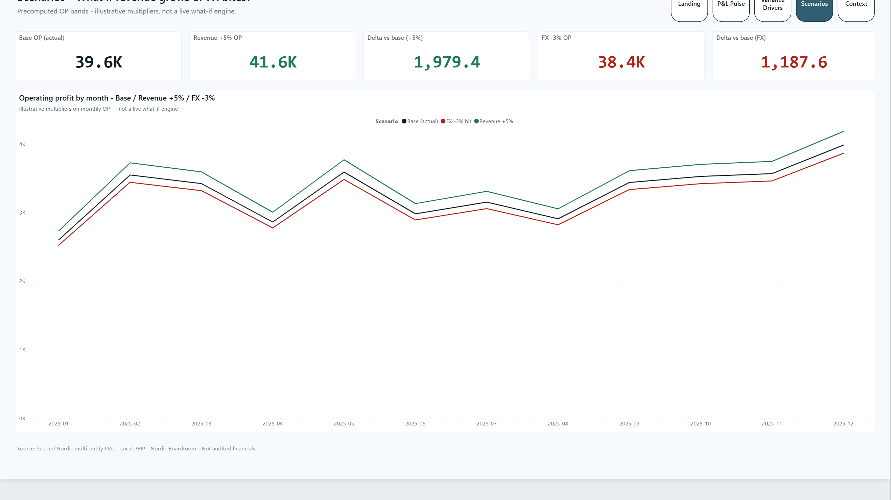
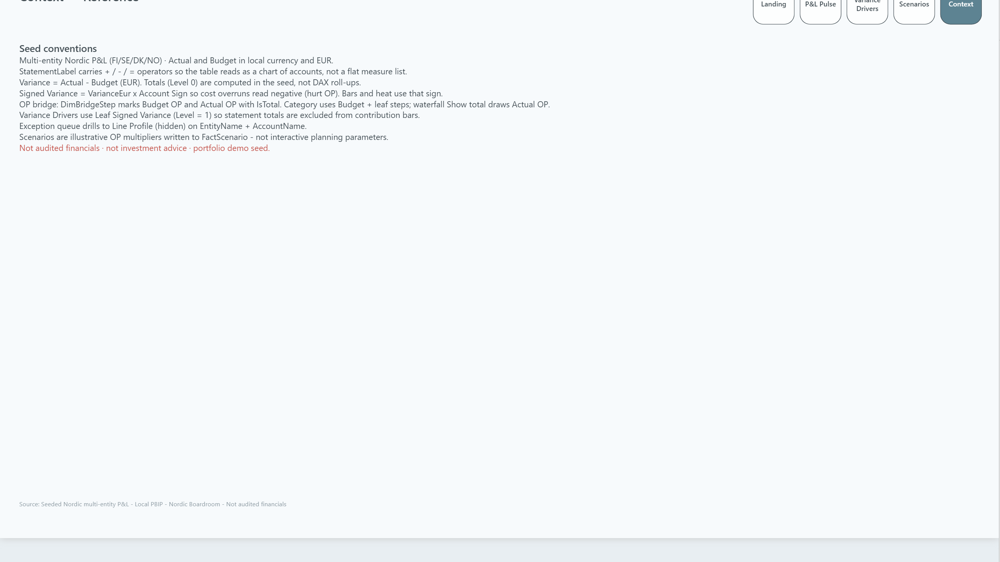

# 10 — Controllership

Nordic Boardroom **FP&A / budget vs actual** report: live Landing thesis, Budget→Actual OP bridge, CoA statement, variance drivers, illustrative scenarios.

**Status:** Featured  
**Audience:** CFO / FP&A  
**Theme:** Nordic Boardroom · Landing atmosphere `alpine-mist`

## Preview











## Pipeline

```powershell
node scripts/seed-fpa-gold.mjs
node scripts/scaffold-fpa-pbip.mjs
node scripts/elevate-fpa-report.mjs
powerbi-report-author validate Controllership.Report
# Desktop open + Refresh, then:
py -3.12 ../_shared/scripts/capture_showcase.py capture . --pid <pid>
```

## Pages

| Page | Role |
|------|------|
| **Landing** | Poster · live DAX conclusion · OP gap KPIs |
| **P&L Pulse** | OP bridge · KPI sparklines · track · CoA · exception queue (drillthrough) |
| **Variance Drivers** | Entity Actual/Budget · monthly gap slope · heat |
| **Scenarios** | Base · Revenue +5% · FX -3% OP bands + deltas |
| **Context** | Seed conventions · signed-variance · bridge / drill notes |
| **Line Profile** | Hidden drillthrough from the exception queue |

## Spec

[`_brief/report-spec.md`](_brief/report-spec.md)
