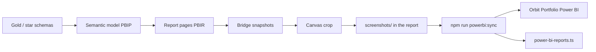

# Power BI portfolio pipeline

How reports move from local PBIP work to the Orbit Portfolio showcase.

The last local step, once a report is finished, is `capture_showcase.py`. The Desktop Bridge snapshot is the report surface: it does not include the ribbon, the visualizations pane, the data pane, or the page tabs. The crop then drops the Filters pane and any fit-to-page margin, and writes a canvas PNG per page under that report's `screenshots/`.
