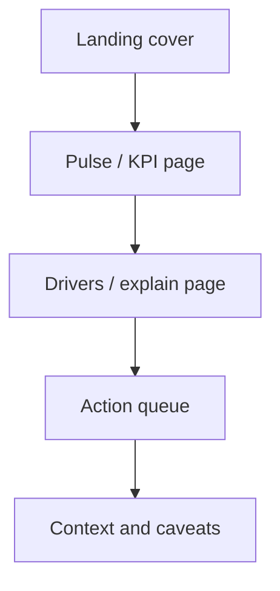

# Report page contract

Each portfolio report follows the same reader path so a hiring manager can scan without guessing where to look.

Instrument pages stay on that path. A duration question — a clock plus a censoring flag — also gets an argument page. The contract for that page, the fit tables, and the citation rule live in [analytics-engine.md](analytics-engine.md). The argument page prints the binding from `figures.json` under each figure.
